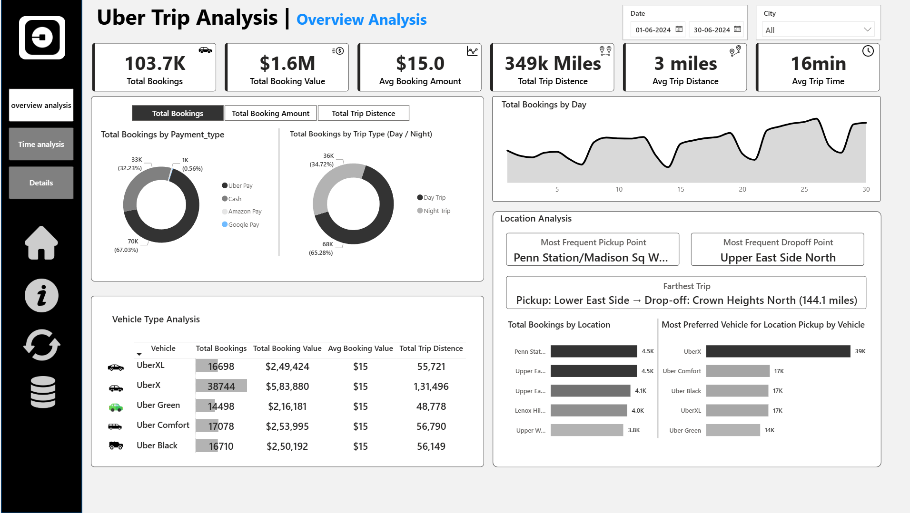
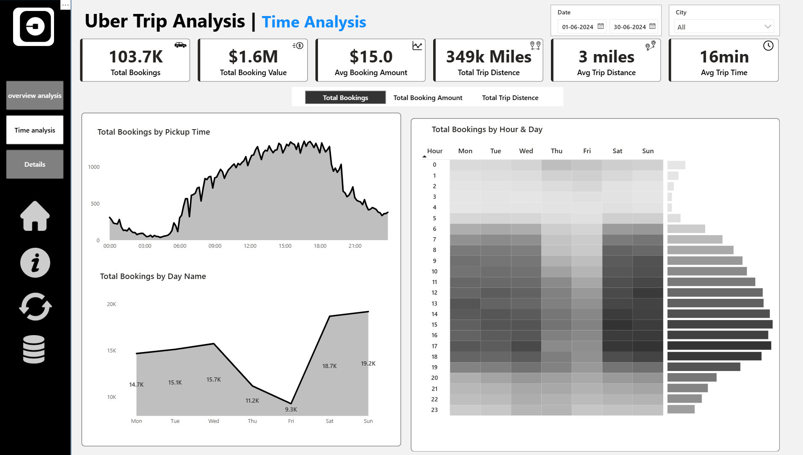

# Uber Trip Analysis | Power BI Dashboard

An interactive Power BI dashboard analysing Uber trips for **June 2024** (01-06-2024 to 30-06-2024), with filters for date and city.

## Dashboard Pages

| Page | Focus |
|------|-------|
| Overview Analysis | KPIs, payment types, day/night trips, vehicle type analysis, location analysis |
| Time Analysis | Bookings by pickup time, by day of week, and by hour & day heatmap |
| Details | Trip-level detail table |

## Key KPIs

| Metric | Value |
|--------|-------|
| Total Bookings | 103.7K |
| Total Booking Value | $1.6M |
| Avg Booking Amount | $15.0 |
| Total Trip Distance | 349k miles |
| Avg Trip Distance | 3 miles |
| Avg Trip Time | 16 min |

## Screenshots

### Overview Analysis

### Time Analysis

## Data Model

- **Trip Details** (fact table): Trip ID, Pickup Time, Drop Off Time, PULocationID, DOLocationID, fare_amount, Surge Fee, trip_distance, passenger_count, Payment_type, Vehicle, Trip Type (Day / Night)
- **Location Table**: LocationID, Location, City
- **Calender Table**: Date, Day Name, Day Num
- **Dynamic Measure**: drives the Total Bookings / Total Booking Amount / Total Trip Distance toggle

### Measures
Total Bookings, Total Booking Amount, Total Trip Distance, Avg Booking Amount, Avg Trip Distance, Avg Trip Time, Farthest Trip, Most Frequent Pickup Point, Most Frequent Dropoff Point, plus dynamic chart title measures.

## Insights

- Roughly two-thirds of bookings are paid by one dominant method (67%), with cash at about 32%.
- Day trips account for about 65% of bookings and night trips about 35%.
- UberX is the most booked vehicle (about 38.7K bookings).
- Bookings peak between about 15:00 and 18:00 and are lowest in the early morning hours.
- Weekend days (Sat/Sun) have the most bookings; Friday has the fewest (9.3K).
- Most frequent pickup: Penn Station/Madison Sq W; most frequent drop-off: Upper East Side North.
- Farthest trip: Lower East Side to Crown Heights North (144.1 miles).

## Tools

Power BI, DAX, Power Query

## Repository Contents

- `README.md`: project overview
- `01_overview_analysis.png`, `02_time_analysis.png`: dashboard screenshots
- Dataset files (Trip Details, Location Table, etc.)
- Power BI dashboard file (`.pbix`)

## Data Source

Add your data source and licence here (e.g. NYC TLC trip records, if applicable).
